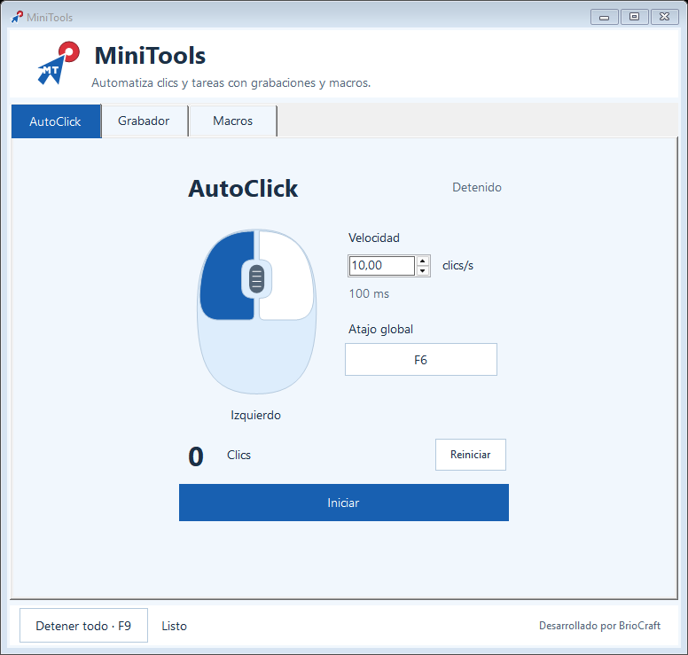
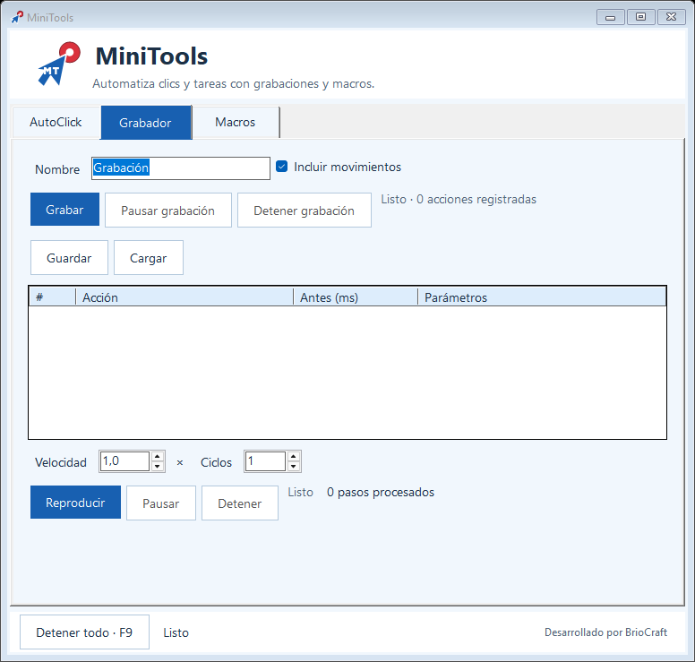
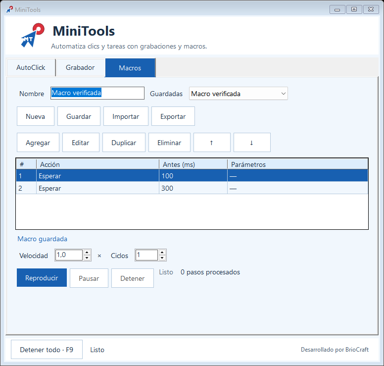

# MiniTools

**AutoClick, grabaciones y macros para Windows.** Desarrollado por **BrioCraft**.
Contacto: [@briocrafttech](https://www.instagram.com/briocrafttech/).

MiniTools 1.4.2 funciona sin conexión y abre siempre detenido. El usuario final
solo necesita `MiniTools.exe`: incluye el runtime, no requiere Python, instalar
.NET ni permisos de administrador para uso normal. El runtime puede extraer
componentes en una carpeta temporal del usuario.



## Funciones

- **AutoClick:** 0,1–100 clics/s, intervalo equivalente, selector visual izquierdo/
  derecho, contador de clics enviados y reinicio estando detenido. Iniciar desde
  el botón da una cuenta regresiva de tres segundos; F6 inicia/detiene al instante.
  El atajo global se captura con el teclado, se guarda al soltar las teclas y
  Escape cancela. No repite activaciones al mantener una tecla; un atajo ocupado
  conserva el anterior. La velocidad real depende de Windows y del equipo.
- **Grabador:** registra presiones/liberaciones de mouse y códigos de teclas,
  movimientos opcionales, pausas y tiempos. Guarda/carga JSON cuando lo solicitas.
  Los controles propios y las entradas inyectadas se excluyen de la grabación normal.
- **Macros:** crear, editar, duplicar, eliminar y ordenar pasos; guardar varias
  secuencias e importar/exportar JSON validado. Importar nunca ejecuta la secuencia.
- **Reproducción:** velocidad 0,1–10×, 1–1000 ciclos, pausa/reanudación y parada.
  Su contador registra pasos procesados, incluidas las esperas.
- **Detener todo:** botón permanente y tecla indicada en la ventana, normalmente F9
  (alternativas F10/F11/F8 si está ocupada). Funciona también con modificadores.
  Solo una herramienta puede grabar o ejecutar a la vez. Cerrar libera las
  entradas enviadas, hooks y atajos.

Los contadores no garantizan que otra aplicación haya recibido una acción.
Windows puede bloquear envíos a aplicaciones con privilegios superiores. Una
secuencia con coordenadas necesita una disposición de pantallas compatible.

## Privacidad y configuración

**El grabador registra códigos de teclas que pueden reconstruir lo escrito. Evita
contraseñas y datos privados durante una grabación.** No extrae el portapapeles ni
captura la pantalla; los JSON guardados no están cifrados. Revisa las acciones de
archivos importados antes de reproducirlos y no publiques grabaciones personales.

Ajustes y macros persisten en `%LOCALAPPDATA%/ClickMoves/` para conservar compatibilidad:
`settings.json`, `automation-settings.json` y `macros/{GUID}.json`. Grabaciones y
exportaciones se guardan donde el usuario elija. Una grabación nueva sustituye la
anterior en memoria; guárdala primero si quieres conservarla. Las configuraciones
se limitan a 64 KiB y profundidad 8; un archivo inválido vuelve a los valores iniciales.
Los documentos de automatización admiten 16 MiB, 100.000 pasos y hasta 24 horas de
espera por secuencia. No se restaura una actividad al abrir.

No hay servidor, navegador, cuentas, autenticación web ni secretos de API. No se
necesita `.env`; [.env.example](.env.example) solo documenta variables opcionales
del tooling/runtime .NET. No se carga automáticamente. Los scripts desactivan
telemetría del SDK y usan cachés locales excluidas de Git. La aplicación no incluye
telemetría ni llamadas de red.

## Desarrollo e instalación reproducible

Requisitos de desarrollo: Windows, PowerShell 7 (verificado con 7.6.5), **SDK .NET 10.0.401** y Git para
las comprobaciones de publicación. No se necesita Visual Studio. `global.json`
fija exactamente el SDK; `Directory.Build.props` fija el runtime **10.0.12**.
Instala el SDK desde [Microsoft](https://dotnet.microsoft.com/download/dotnet/10.0).
La primera restauración necesita acceso a nuget.org; el uso del .exe no.

Desde la raíz:

```powershell
dotnet --version
./restore.ps1
dotnet build tests/ClickMoves.Tests/ClickMoves.Tests.csproj -c Release --no-restore -warnaserror
./test.ps1 -CoreOnly
./build.ps1
```

Resultado: `dist/win-x64/MiniTools.exe`. Distribuye solo ese archivo. Para ejecutar
el código durante desarrollo:

```powershell
dotnet run --project src/ClickMoves/ClickMoves.csproj -c Release --no-restore
```

Los bloqueos `packages.lock.json` se mantienen en ambos proyectos y se restauran
con `--locked-mode`. `NuGet.Config` utiliza únicamente el feed oficial nuget.org.
El proyecto no tiene paquetes de terceros; el bloqueo del programa incluye
`Microsoft.NET.ILLink.Tasks`, tooling implícito de Microsoft para el empaquetado.
La compilación habilita analizadores .NET, tipos anulables y falla ante advertencias.
No se ha impuesto un reformateo de todo el código ni un linter de frontend.

`build.ps1 -Runtime win-arm64` y `-Runtime win-x86` conservan las opciones previas;
estas arquitecturas no se han verificado en equipos reales. El presupuesto x64
es 60 MB. Se conserva la compresión del único archivo, sin trimming de WinForms.
Fijar versiones permite repetir la instalación; no demuestra identidad binaria
entre distintos sistemas. Las actualizaciones de SDK/runtime son deliberadas y
deben revisar avisos de seguridad, regenerar bloqueos y volver a ejecutar las pruebas.

## Pruebas

```powershell
./test.ps1 -CoreOnly   # Lógica y límites: sin mover el mouse del escritorio
./test.ps1             # UI y entradas Win32 en destinos de prueba controlados
./test.ps1 -SmokeOnly  # Requiere el .exe generado; prueba el binario aislado
./scripts/check-publication.ps1
./tests/CheckPublication.Tests.ps1
```

Las pruebas completas y smoke usan un escritorio Windows interactivo: déjalas
terminar sin intervenir con teclado/mouse. Generan reportes y capturas únicamente
en rutas excluidas de Git. El arnés no es `dotnet test`; ejecutarlo con ese comando
no verifica estas pruebas. La CI ejecuta lógica, analizadores y empaquetado, sin
usar entradas globales en el escritorio del runner.

[Revisión y resultados](docs/REVISION.md) · [Estructura](docs/DESARROLLO.md) ·
[Publicación y decisiones](docs/PUBLICACION.md) · [Reportar seguridad](SECURITY.md)




## Licencia

No se encontró una licencia existente y no se ha añadido una sin decisión del
propietario. Publicar en GitHub no concede automáticamente una licencia de código
abierto; los términos de GitHub permiten ver y bifurcar repositorios públicos.
Decide las condiciones del código y de los recursos antes de publicarlos para
reutilización. [Guía de licencias de GitHub](https://docs.github.com/en/repositories/managing-your-repositorys-settings-and-features/customizing-your-repository/licensing-a-repository).
